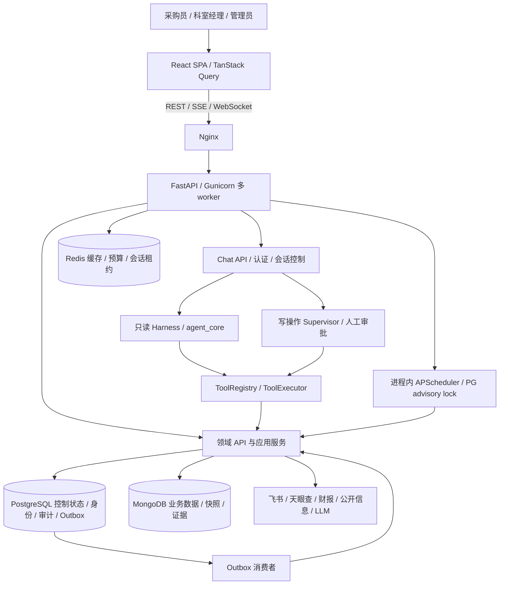

# SuppliSense 全项目架构评审

评审日期：2026-10-18（Asia/Shanghai）
代码基线：`328a569d`，分支 `codex/2026-09-23`
范围：产品边界、前后端、Agent、数据、外部集成、权限、任务、实时通信、部署、测试与架构治理。

## 1. 总体判断与证据口径

**架构选型适合当前采购风险分析产品；实现已超出原型，但运行可靠性与策略一致性尚不足以支持直接扩大企业生产使用。** 建议保留模块化单体、Harness、关系型控制面和现有前端技术栈，优先修复执行生命周期和数据可信度。

设计方向可评约 **8/10**；按当前实现的生产成熟度，综合约 **6.5/10**。这是基于代码和局部验证的工程判断，不是基准测试、生产 SLA 或安全认证。分数用于定位改进方向，关键 P1 问题是否关闭比平均分更有决策意义。

本次分四个方向核查：Agent；后端领域与数据；前端；跨层安全、部署及测试。以活动路由和真实调用链为依据，未把历史设计当作现状，也未把旧图文件的存在等同于活动多内核。

核查覆盖全部主要子系统的入口、核心实现及对应测试；没有逐行审计每个分支，也没有进行生产负载、跨进程故障注入或完整外部供应商数据验收。两份未提交的 2026-10-13 设计草案未被当作已实现能力。

规模仅用于理解维护成本：后端应用 210 个 Python 文件、约 53,229 行；后端测试 140 个文件、约 31,626 行；前端 src 72 个 TS/TSX 文件、约 12,711 行（含测试）。行数不代表质量或覆盖率。

## 2. 当前实际架构

### 2.1 后端是模块化单体

当前主要业务在 `app/domains/` 的十个领域中：auth、company、supplier、sourcing、sourcing_risk、risk、alert、agent_run、outbox、knowledge。`knowledge` 未形成活动检索服务；未发现活动向量库或向量 RAG 链路，寻源目前主要使用结构化查询和关键词匹配。

`api/` 承担聊天及跨域入口，`services/` 主要保留调度、飞书、天眼查、会话等跨领域能力，仓储多数已进入领域目录。根部规范展示的纯横向 API→service→repository 结构已经不能完整描述实际代码。

这个规模继续用单体是合理选择：身份、权限、审批和评分仍紧密关联，过早拆成微服务会增加跨服务事务、部署和排障成本。可以先分离运行进程，保持同一代码库和明确的应用服务边界。

### 2.2 Agent 的活动链路已收敛

`chat.py:17` 有路由级认证。普通聊天和只读旧 mode 均归一化为 Harness（`chat.py:417`）；写请求保留持久化 Supervisor。不是 README 旧版本里描述的多种图按 mode 自由切换。

只读图主要为：`load_session → resolve_turn → build_plan → execute_ready_tasks → validate_evidence → bounded remediation → render_answer → persist_turn`。共享 adapter 在请求中构建一次执行上下文；工具通过统一 Executor；证据、Claim 和 AgentAnswer 分层形成最终结果。

写链路通过 Proposal、人工确认、审批令牌、参数绑定、幂等键和真实回执约束。保留两个图的兼容边界可以接受，关键是两者共享动作与证据政策，并最终具有同一种持久化生命周期。

### 2.3 数据权属基本合理

| 存储 | 当前主要职责 | 评价 |
| --- | --- | --- |
| PostgreSQL | 用户、责任快照、规范企业身份、Session/Turn/Run/Task、审批、审计、Outbox | 适合需要事务、约束和恢复的控制状态；应是这些状态的唯一权威记录。 |
| MongoDB | 外部业务数据、供应商读模型、监控对象、风险/舆情快照、展示证据、通知 | 适合来源异构的数据与快照；监控对象和通知属于业务状态，不能当作可随意丢弃的缓存。 |
| Redis | 缓存、付费预算、会话租约 | 职责已超过可丢弃缓存；预算和并发控制的故障政策需分别定义。 |
| 飞书 | 正式供应商主数据及责任分配来源 | 只读同步边界与当前产品定位一致；需保留同步版本、来源状态和失败可见性。 |

三库不是天然过度设计，但它们增加了恢复、一致性和运维成本。当前应补齐跨库投影和灾备，而不是直接再添加消息中间件或向量数据库。

## 3. 分维度评价

| 维度 | 参考评分 /10 | 主要判断 |
| --- | --- | --- |
| 产品边界与技术选型 | 8 | 采购辅助、来源标注、只读主数据、人工审批的边界清楚；FastAPI + React SPA 适配工作台。 |
| 后端领域与依赖 | 7 | 领域目录和应用服务已形成；旧 API、领域直连数据库及反向依赖仍让政策分散。 |
| Agent 与证据控制 | 7 | 单一只读入口、统一工具执行与事实契约值得保留；标题门禁和生命周期有实质缺口。 |
| 数据身份与一致性 | 6 | 稳定 ID、Outbox、幂等基础较好；名称回退、快照版本、跨库双写仍不可靠。 |
| 前端状态与交互架构 | 7 | 查询库、页面拆包、持久化任务视图有效；多流隔离、回放和缓存失效没有统一状态模型。 |
| 权限与执行策略 | 6 | 普通 HTTP 和主要监控写路径有较好校验；旧付费入口和 WebSocket 未共享完整策略。 |
| 部署、恢复与扩展 | 5 | 容器、探针、非 root、日志轮转已有；多进程推送、调度接管和完整灾备尚未闭环。 |
| 测试与发布门禁 | 7 | 有真库 CI、Agent E2E 和核心覆盖率门槛；测试组合边界与离线隔离不足。 |
| 文档与架构治理 | 5.5 | 问题记录和实施计划充足；活动规范彼此矛盾，历史与现状仍易混淆。 |

## 4. 优先修复的架构问题

下列编号对应 `docs/issue-log.md` 中的 `ISS-20261018-NNN`。P1 为扩大使用前应处理的正确性、权限或可靠性问题；P2 为后续工程加固。静态可达性与代码缺陷不代表已证明线上发生过事故。

### 4.1 执行策略没有覆盖全部活动入口（001，P1）

`main.py:268` 仍挂载旧 `/api/v1/async`。`async_tasks.py:55-76` 只做角色校验，未下传操作者；`tasks/risk_tasks.py:41` 直接付费抓取，`:63` 无范围读取全量监控名单。它们绕过 `/alert` 新入口的额度预留及必需审计。

离线使用实际 router、采购员身份和任务替身，任意公司单家刷新和全量刷新均得到 200，任务没有收到用户范围。没有消耗真实外部额度。另外 `/alert/refresh-all` 自身 `alert/api.py:1022,1029` 也按全量名单运行，范围缺口不只在旧接口。

**建议：**把“允许谁、可操作哪些对象、付费额度、审计、幂等”收口为同一个应用操作。所有 REST、旧兼容入口、工具和后台任务调用它，并显式区分用户范围操作与系统全量操作。旧 URL 可以保留，但不再保留第二套执行政策。

### 4.2 评分仍会把模型故障解释为安全（002，P1）

`risk/soft_risk.py:59-65` 在 LLM 不可用时返回四项 0 风险；`risk/service.py:473-492` 正常累计并标记“已纳入”，`:301` 仅按是否启用软指标判断覆盖。安全分越高越安全，软指标正常占 25 分；故障可能让这一部分贡献满额安全分，且产生错误覆盖说明。

软评分调用仅传企业名称，没有传入已有证据上下文。temperature=0 和 JSON 校验只能约束格式，不能证明模型拥有这些公开事实。

**建议：**将成功、无记录、未查询、提供方故障分开；覆盖度消费实际结果状态。缺证据时给部分评估和待复核说明，不能以完整低风险结论收口。数值是规则安全分，不应被解释为校准过的违约概率。

### 4.3 “持久化运行”尚未成为可靠的运行生命周期（003、004，P1）

- 取消接口只把 PG Run/Turn 写为 CANCELLED（`agent_run/service.py:438`），活动图不检查取消；后续 snapshot 会无终态保护地更新状态（`state_store.py:202-225`）。工具返回后可以重新变成 RUNNING/COMPLETED。
- SSE generator 结束时会取消图任务（`graphs/streaming.py:301-303`），却没有明确持久化中断状态。现有重建恢复只支持 Supervisor（`api/chat.py:282-291`），Harness 的 GET events 是事件回放，不是继续执行 checkpoint。
- 图在 `harness/graph.py:1999` 先提交终态 snapshot，再由 `streaming.py:221-229` 发布公共答案事件；回放器 `agent_run/service.py:536-540` 看到终态即结束，有机会在最终公共答案/done 入库前关闭。
- 前端 ChatView 的 run ID/cursor 仅在 send 闭包中保存（`ChatView.tsx:264-269`），刷新后恢复的是本地展示历史，不能重建活动运行视图。

**建议：**统一 Run 状态机，终态不可回退；引入协作取消和持久化取消意图。明确选择“独立 durable worker 继续运行”或“可恢复暂停并真正续跑”。终态与最终公共事件同事务提交，界面挂载时按 run ID 对账；不要用“已有 checkpoint”代替恢复验收。

### 4.4 最终自然语言没有完整经过事实门禁（005，P1）

`agent_core/narrator.py:118-144` 只检查 body 的数字、企业和成功动作短语，`:252` 却将 headline 一起交付。已用纯内存对象复现：仅有安全分 85 的 Claim 时，“陌生有限公司已加入监控，评分999”作为标题仍通过校验。带有合法数字和 Claim ID 的正文也能追加无依据的定性指控。

**建议：**对全部可见输出应用同一政策；关键风险判断来自有依据的结构化字段，文字负责解释这些字段。Claim 引用、数字白名单与语义事实支持需要分别验证。无需用另一个无限制 LLM 循环替代现有确定性约束。

### 4.5 稳定身份被旧名称兼容查询削弱（006，P1）

`alert/service.py:215-220,545-550,565-568,587-592` 在稳定 ID 无快照或不足两份时按企业名回退，却未限制回退数据必须缺失 ID。同名不同对象、移除重建对象可能读取或比较其他对象的快照。

**建议：**带稳定 ID 的数据只按 ID 读取。迁移期的旧数据回退至少要求缺失 ID，且需处理同名歧义；迁移完成后移除名称回退。company、supplier、candidate、monitor target 四种身份设计应继续保留。

### 4.6 多 worker 部署与后台/推送实现不匹配（007、008，P1）

PG advisory lock 能避免启动时重复调度，但 `scheduler.py:168-173` 的 follower 一次失败即退出，不再争取领导权；leader 连接丢失时 `scheduler_leadership.py:16-18` 不验证其仍持锁。连接故障可能导致停调度，随后新 worker 又可能与旧 scheduler 并行。

WebSocket 连接表只在进程内（`ws_manager.py:10-14`），默认 Gunicorn 有四个 worker。调度所在 worker 的广播无法找到其他 worker 的连接。前端 `Layout.tsx:24-38` 又未订阅风险事件来失效风险查询，即使事件送达也不能自动更新主要看板。

**建议：**先把 scheduler/Outbox 执行进程从 Web worker 生命周期分离，或实现有效租约、周期重选与失权停止。WS 经进程间事件分发，前端统一处理风险事件并在重连后拉取快照。推送是更新提示，持久化通知/业务快照才是事实来源。

### 4.7 认证与限流边界不一致（009、010，P1）

`main.py:334-338` 加载用户后，无论用户已删除或禁用都接受 WebSocket。用模拟签名身份和用户查询替身已复现这两种情况；HTTP `get_current_user` 会拒绝它们，WS 没有复用完整政策。

`core/rate_limit.py:13-15` 信任 X-Forwarded-For 第一个值，Nginx `nginx.conf:23` 追加客户端已有头，来访者可控制限流键。Limiter 实际使用 MemoryStorage，每个 worker 单独计数，不是集群额度。

**建议：**WS 握手和长期连接遵循当前账户状态政策，验证必要的 Origin；令牌过期/禁用后的连接失效行为需明确。代理头只从可信链解析，边缘清洗来访头，限流使用共享存储并区分身份与 IP。

### 4.8 前端缺少以 Run 为单位的流状态隔离（011、012，P1）

`ChatView.tsx:201-207` 的正文、引用、证据和审批累积器是组件共享 refs；新建/切换会话只清理 loading（`:749-760`），不取消旧流。A 未结束时发送 B，两条流可以读写同一累积器。现有测试只证明选中会话保持正确，未覆盖两条流交错。

`api.ts:322-343` 的 resumeChat 缺少 chatStream 已有的终态检测。离线模拟只收到 thinking 后正常 EOF，函数正常返回且 onDone 为 0；ChatView 的审批状态因此可永久保留 submitting。

**建议：**用 run 局部状态或 reducer 管事件，回调绑定 run ID；支持取消订阅与后台运行的明确选择。审批传输中断进入“结果待对账”，查询持久化事实，避免卡死或盲目重试写操作。

## 5. 其他需要纳入工程计划的问题

| 编号 / 优先级 | 已核实问题与证据 | 建议 |
| --- | --- | --- |
| 013 / P2 | `harness/graph.py:1557,1997` 的 LLM 计数未涵盖图外意图、修复重试、工具内部模型调用；`sentiment.py:85` 无显式模型调用超时；同步线程超时后仍可继续执行。 | 普通模型调用上下文贯穿总 deadline、retry、usage、并发和费用；服务层保持框架无关。 |
| 014 / P2 | Executor 权限查询（`tools/executor.py:129`）、展示存档（`streaming.py:392`）及部分审批 claim/ack 在 async 流内直接同步访问数据库。 | 将已定位的同步访问移出事件循环，结合连接池等待和数据库超时验证；无需一次性重写所有驱动。 |
| 015 / P1 | 意图支持每日/月度报告，Supervisor `graph.py:478-488` 却固定 create/weekly/excel；取消 regex `chat_recovery.py:8` 可将“分析停止供货的影响”当作取消。 | 用结构化 action/frequency/format/target 表达任务；控制命令需要明确作用对象，并加入否定/业务词边界测试。 |
| 016 / P2 | `scheduler.py:56-75` 财务更新沿用旧总分/无快照时用0，缺少原评分解释，却写新检查时间和当前评分版本。 | 证据刷新与完整评估分开；按相同证据版本重算，或保存独立财务快照。 |
| 017 / P2 | `alert/service.py:499-526` read+1 生成版本，相关索引非唯一，并发评估可重复版本和前驱。 | 原子计数/CAS、唯一约束与明确的新旧评估提交政策。 |
| 018 / P2 | `risk/service.py:132-148` Mongo成功后写PG历史失败被直接忽略，快照与趋势可永久分叉。 | 唯一 assessment ID、权威记录与可重试投影；至少保留异常及待补偿状态。 |
| 019 / P2 | `mongo.py:76-80` 只核对索引字段不核对unique/sparse；`:217-218` 建索引失败仅warning。每个worker启动执行schema DDL（`main.py:153-154`）。 | 将迁移从请求服务启动中分离；关键业务约束验证失败应阻止提供对应能力，性能索引可另行创建。 |
| 020 / P2 | REST读取 `data.detail`，后端返回 `{error:{code,message,detail}}`；事件流 `api.ts:367` 绕过认证刷新，401被hook每秒重试。离线实验分别得到“422”和未刷新认证的HTTP401。 | 共享 ApiError/认证传输，区分永久错误与可重试网络错误，保留错误码。 |
| 021 / P2 | `MonitoringView.tsx:115-119` 更新后未使 `monitor-risk-detail` 查询失效，新列表与旧证据可同时显示。 | 查询键统一管理，以写操作的影响范围驱动失效，显示快照版本。 |
| 022 / P2 | 后端依赖全部使用下界；CI和镜像直接pip install，无已提交锁定文件，重建可能得到不同LangGraph/OpenAI/Pydantic组合。 | 锁定实际解析结果，在CI和镜像使用同一依赖集；测试依赖与运行依赖可分离。 |
| 023 / P2 | backup/restore与定时示例仅覆盖Mongo；曾有PG手工备份记录，仓库未提供持续PG备份、配套恢复及演练流程。 | 覆盖PG控制面/审计、Mongo业务数据及checkpoint，定义RPO/RTO并实际恢复到隔离环境。不能据此推断外部运维一定没有备份。 |
| 024 / P2 | CLAUDE.md:38仍说ReAct生产默认；AGENTS仍要求保留已不存在的agent.py.chat；AssessView无活动路由，旧类型与测试独立保留。 | 同步唯一活动架构说明，历史标记清楚；旧界面测试迁移后再清理，保留所需回归覆盖。 |
| 025 / P2 | `sourcing_risk/action_service.py:629-630,740-741` 与 `graphs/harness/durable_actions.py:45` 双向依赖。延迟导入避免了当前加载异常，但审批契约归属不清。 | 共享contracts/policy由领域应用服务与图共同依赖，保持唯一实现；不必再复制一套审批。 |
| 026 / P2 | `agent_session_guard.py:44-54` Redis异常自动降级进程锁；租约仅在产出事件时续期，`chat.py:739` 忽略续期失败。 | 生产并发控制需明确失败关闭或使用PG兜底，独立心跳及失权停止，不能把进程锁当分布式互斥。 |

仍有效的已知问题另引用原条目：`ISS-20261016-002` 范围读取在鉴权前回填旧对象；`ISS-20261016-003` 批量部分写入缺少完整回执/审计；`ISS-20261015-006` 非集成测试仍访问真库。本次不重复创建同名问题。

## 6. 应当保留的设计及适用边界

### 6.1 FastAPI、同步驱动与线程隔离

保留同步PyMongo/psycopg2并不错误，已有大量同步业务服务可复用。条件是同步I/O完整隔离、线程/连接池有上限、请求有端到端预算。现在的瓶颈更可能是外部调用、长事务/连接等待和少数遗漏阻塞点；没有负载证据支持直接更换框架。

四worker与每worker PG_POOL_MAX=20意味着主连接池最多80条，另有checkpoint和调度连接；需要与PG资源、线程并发、外部提供方额度共同做容量预算。这是待测容量风险，不代表已经耗尽连接。

### 6.2 Harness 的确定性编排

风险分析需要稳定主体、完整维度和可追溯结论，受约束规划比让模型任意生成执行路径更合适。保留确定性主体归一化、任务矩阵、依赖和有限补证循环。

其维护风险是大量语义补丁散落在路由、意图、adapter和图中。应沉淀可测的能力/控制意图契约与表达矩阵，避免每个新问法都在多个层追加正则。不要通过再引入一种Agent内核解决路由偏差。

### 6.3 Outbox 与幂等

企业身份变化的事务内Outbox、`SKIP LOCKED`、租约、指数重试、死信和回放审计，是值得保留的工程基础。投递保证应描述为“至少一次 + 消费者幂等”；`outbox/service.py:88-92` 的handler执行与消费确认分开，崩溃窗口仍会重投，不能宣称exactly once。

为每个消费者验证持久化幂等和慢处理超过租约的行为，再考虑独立worker或队列扩容。没有当前吞吐证据要求立即引入Kafka/Celery。

### 6.4 前端状态方案

React SPA + TanStack Query适合后台工作台，不需要为本次问题改成SSR或另加全局状态库。页面懒加载已经生效；生产构建入口约465kB/gzip147kB，ChatView约275kB/gzip78kB。没有实测交互延迟，不能只凭包大小认定严重性能问题。

前端真正需要的是运行状态与查询状态的边界：服务端Run为权威、本地历史为展示缓存、每个run隔离事件、每次写入明确失效哪些查询。前端集中types和扁平目录符合现有项目规范，暂不建议仅按文件长度拆目录或引入状态库。

### 6.5 部署与可观测性

已有非root后端镜像、健康/就绪区分、依赖健康等待、日志轮转、资源限制、请求ID、Sentry、低基数Prometheus标签及多worker指标聚合。SSE已有禁缓冲响应头，不应误报为完全没有流式代理配置。

Compose交付仍是单主机、单数据库实例拓扑。仓库Nginx仅监听HTTP80，生产HTTPS需明确由外部入口终止TLS，并与Secure Cookie和可信代理配置匹配。`/metrics`仅在配置token时受限；日志尚无通用字段脱敏策略。应定义部署前提、访问范围、密钥轮换和恢复步骤。

下一步指标应对应用户结果：最终答案成功/部分完成率、证据缺失率、取消生效时间、恢复成功率、审批待对账时长、Outbox积压、通知投递时延、每Run模型费用和p95/p99耗时。已有指标不等于已证明SLO达标。

## 7. 验证结果与局限

| 核查 | 本次结果 | 能说明什么 |
| --- | --- | --- |
| 前端Vitest | 19文件、138测试通过 | 现有组件/协议测试通过；不能证明两流交错、真实代理和跨进程推送正确。 |
| 前端Lint与生产构建 | 通过，构建包含tsc -b | 当前类型、规则和产物可构建；未证明运行时数据满足类型声明。 |
| Harness runtime / narrator / session guard 定向测试 | 30通过 | 现有离线测试可运行；新增生命周期与对抗案例仍缺覆盖。 |
| 健康、指标、审计、认证线程、scheduler、发布清单定向测试 | 32通过、1项因PG连接拒绝失败 | 该项需真实PG，不能当产品缺陷，也不能算验证通过；确认非集成标记隔离仍不完整。 |
| 限流探针 | 接受来访XFF首值，存储为MemoryStorage | 已确认限流键可控及进程内存储。 |
| WS握手探针 | disabled/removed模拟用户均被accept | 已确认未复用HTTP当前用户有效性策略；未向真实用户连接发消息。 |
| 叙述/频率/传输探针 | 标题绕过、月度变周度、审批EOF、错误信封及事件401均复现 | 使用内存对象/mock，不消耗LLM或付费数据额度。 |
| 完整真库、真实浏览器、生产压力与灾备恢复 | 本次未执行 | 不引用历史报告替代本次生产验收。 |

CI已有真PG/Mongo/Redis、Agent E2E、核心Harness定向80%和总体20%覆盖率门槛。整体20%过低，且定向80%是所选模块聚合值，不能证明每条安全边界已覆盖。前端ChatView测试mock整个API模块，后端取消测试预置静态Run，恰好避开本次发现的交错和并发问题。

优先补组合/故障测试：所有活动入口的统一策略、真图并发取消、断连后续跑、最终事件竞态、两会话交错、审批EOF对账、WS跨worker投递与缓存更新、同名不同ID、并发快照、LLM失败覆盖、索引漂移、scheduler失权接管。无需为了提升百分比批量增加镜像实现的断言。

## 8. 建议实施顺序与验收条件

1. **统一业务操作和评分失败语义。** 关闭001/002/005/006/009/010；覆盖旧入口、标题、未知证据和身份回退。验收：任何入口都不能绕过相同政策，未知不能产生完整低风险或写成功声明。
2. **统一Run生命周期与前端视图。** 关闭003/004/011/012/015，修复终态事件提交与恢复。验收：运行中取消不回退；断连/刷新能继续或明确中断；两流不污染；审批不留永久submitting。
3. **完成多进程运行边界。** 关闭007/008/013/014/026。验收：杀leader能接管且不双执行；风险事件跨worker到达且页面更新；预算包含预处理、工具内LLM和重试。
4. **收口数据一致性与交付。** 处理016至025及已有待修条目。验收：评估ID/版本可追踪，跨库失败可补偿，关键约束失败不静默提供能力，构建依赖可复现，PG+Mongo可恢复。

这条路线保留现有可工作的技术栈和业务功能，把优化集中在可证明的错误边界。达到上述条件后，再用真实负载决定是否需要独立更多服务、异步驱动或更复杂的消息基础设施。

## 9. GitHub 外部架构参照

后续调研核对了业务相近项目、企业AI平台及持久执行库，见[GitHub类似项目与架构调研](github-architecture-research-2026-10-18.md)。主要可借鉴对象是Auroraexo的审核/通知边界、ERPNext与CISO Assistant的业务模型、Dify与Onyx的运行/订阅分离，以及LangGraph前端与DBOS/Temporal的恢复机制。调研进一步支持先完善当前架构的执行政策、状态机和worker边界；未据此调整为整体框架迁移。
