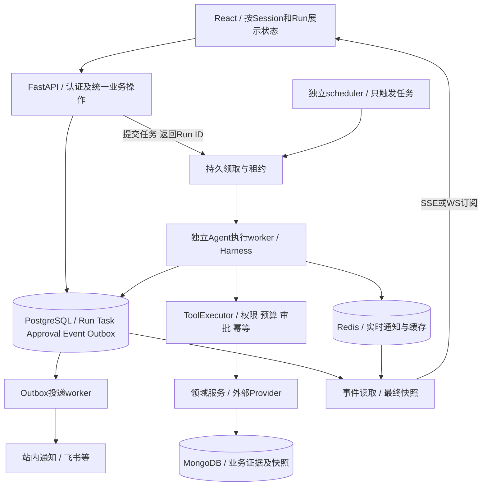

# GitHub 类似项目与架构调研

调研日期：2026-10-18（Asia/Shanghai）
对照项目：SuppliSense，代码基线 `328a569d`
关联：[项目架构评审](architecture-review-2026-10-18.md)

## 1. 调研结论

**存在业务和技术栈都很接近的开源项目，但当前样本中没有核实到一个可直接替代 SuppliSense、同时完整覆盖企业权限、证据可信度和运行恢复的成品。** 最有用的方式是分别参考业务建模、Agent运行控制和前端订阅机制。

- 业务与技术栈最接近：**Auroraexo / Supply-Chain-Risk-Control-System**。可参考审核事务、处置状态和通知Outbox；它的LangGraph仍使用内存checkpoint。
- 供应商风险解释最接近：**Xin-Ethan-Li / supplier-risk-intelligence**。可参考评分/证据/融合政策分离、版本化产物和缺证据状态；属于合成数据演示。
- 采购业务评分：**ERPNext Supplier Scorecard**。可参考统计周期、指标权重、评级政策和业务闭环。
- 第三方风险与证据模型：**CISO Assistant**。可参考法律主体、产品服务关系、评估和外部评分历史的区分。
- Agent产品工程：**Dify、Onyx**。可参考进程职责、运行协调器、暂停恢复、断连回放和作用域检查。
- 运行/前端基础设施：**LangGraph Agent Chat UI、DBOS、Temporal官方样例**。可参考thread/run视图和持久执行机制；需要明确接入成本及保证边界。

这些证据支持保留 SuppliSense 的 FastAPI、Harness、PostgreSQL控制面和React。优先改进“请求、执行、订阅、业务动作”的边界。引入更多Agent、拆更多服务或添加向量库，不会自动解决当前问题。

## 2. 方法与样本口径

筛查11个公开仓库，重点核查下列9个。阅读原作者README/文档后，再核对实际图、应用服务、模型、部署、worker、流处理、测试及许可证；不以stars或README中的“production-ready”作为成熟度证明。

部分GitHub页面搜索缓存不可读，通过GitHub公开API和原始文件核实。关键源码链接固定到以下提交；原作者站点及上游部署仓库链接按调研日读取。未运行外部项目、未调用其LLM或付费API、未进行生产容量验证，也未将外部源码引入本项目。

| 项目 | 核查分支 / 提交 | 定位与证据等级 |
| --- | --- | --- |
| [Auroraexo/Supply-Chain-Risk-Control-System](https://github.com/Auroraexo/Supply-Chain-Risk-Control-System) | main / `326c972e6171` | 相近业务的早期实现；核对了实际事务、图及通知worker。 |
| [Xin-Ethan-Li/supplier-risk-intelligence](https://github.com/Xin-Ethan-Li/supplier-risk-intelligence) | main / `27cbf77cb96b` | 明确标注portfolio demo；核对了评分、融合、产物版本及Compose。 |
| [frappe/erpnext](https://github.com/frappe/erpnext) | develop / `061af2367d04` | 持续发行的ERP；核对了Supplier Scorecard及采购集成。 |
| [intuitem/ciso-assistant-community](https://github.com/intuitem/ciso-assistant-community) | main / `af1eee4f2a7f` | 持续发行的GRC产品；核对了TPRM模型、配置及任务进程。 |
| [langgenius/dify](https://github.com/langgenius/dify) | main / `47b6712a3789` | 通用AI产品平台；核对了运行协调、异步任务、暂停及部署。 |
| [onyx-dot-app/onyx](https://github.com/onyx-dot-app/onyx) | main / `40238683c9c7` | 企业知识/聊天平台；核对了执行线程、流缓存、恢复和权限路径。 |
| [langchain-ai/agent-chat-ui](https://github.com/langchain-ai/agent-chat-ui) | main / `088908b81872` | LangGraph官方前端参考；核对了thread、SDK流和interrupt交互。 |
| [dbos-inc/dbos-transact-py](https://github.com/dbos-inc/dbos-transact-py) | main / `61426cb95bcd` | PostgreSQL持久执行库；核对了恢复入队实现和官方保证。 |
| [temporalio/ai-cookbook](https://github.com/temporalio/ai-cookbook) | main / `51101044074b` | 官方AI工作流样例；核对人工审批的Activity、Signal及超时等待。 |

## 3. 与业务最接近的项目

### 3.1 Auroraexo：供应链风险分析、规则决策与人工审核

**实际架构：** React → FastAPI → 应用服务 → LangGraph的Scout、Analyst、条件Reflection、Decider、人工复核；关系库保存原始数据、分析结果、决策和审计。部署还包括MySQL、Redis、RabbitMQ及独立通知worker。图的条件边可在数据质量不足、重试耗尽或高风险时进入人工复核。

风险服务将分析、决策及通知Outbox放在同一数据库事务。通知worker使用 `FOR UPDATE SKIP LOCKED` 领取待发布事件，再投递RabbitMQ；队列持久化、消息persistent、publisher confirm、重试及死信均有实际实现。见[风险服务](https://github.com/Auroraexo/Supply-Chain-Risk-Control-System/blob/326c972e6171183c13974ef1b9e97ee65801bb32/app/services/risk_service.py#L296)、[通知worker](https://github.com/Auroraexo/Supply-Chain-Risk-Control-System/blob/326c972e6171183c13974ef1b9e97ee65801bb32/app/workers/notifications.py)、[MQ实现](https://github.com/Auroraexo/Supply-Chain-Risk-Control-System/blob/326c972e6171183c13974ef1b9e97ee65801bb32/app/core/mq.py)。

审核服务对决策行加锁，检查待审状态，覆盖或驳回要求理由，审核结果和审计一起提交。这体现“分析结果、机器决策、人工结论、后续处置”应分开。见[审核服务](https://github.com/Auroraexo/Supply-Chain-Risk-Control-System/blob/326c972e6171183c13974ef1b9e97ee65801bb32/app/services/decision_service.py#L199)。

**需要保留的判断边界：** 数据库审核能在重启后查询，不代表图能从断点继续。该图明确使用 `MemorySaver`，人工节点走向END；没有据此证明持久化interrupt/resume。通知去重也不能消除SMTP成功到记录成功之间的全部崩溃窗口。见[图定义](https://github.com/Auroraexo/Supply-Chain-Risk-Control-System/blob/326c972e6171183c13974ef1b9e97ee65801bb32/app/agents/graphs/decision_graph.py#L244)、[人工节点](https://github.com/Auroraexo/Supply-Chain-Risk-Control-System/blob/326c972e6171183c13974ef1b9e97ee65801bb32/app/agents/nodes/human_review_node.py)。

**对SuppliSense的建议：** 保留现有更严格的审批签名与幂等边界，借鉴独立通知执行、单库事务Outbox和处置状态。我们已经有Outbox，无需仅因为这个项目用了RabbitMQ就再引入一个broker。它有测试和Alembic迁移，但本次未验证真实MySQL/MQ故障恢复，按早期参考实现看待。

### 3.2 Supplier Risk Intelligence：评分、检索与解释分离

**实际架构：** Astro界面 → Fastify公共API → FastAPI风险引擎；Python加载版本化XGBoost与只读检索产物。训练、文档准备及索引构建在离线路径，在线只做推理、检索和融合。公开Compose没有启动PostgreSQL或Redis，架构文档将二者标为可选完整profile，不能描述成它的必需运行依赖。见[架构文档](https://github.com/Xin-Ethan-Li/supplier-risk-intelligence/blob/27cbf77cb96b5fdf79c5a6cd5d94a8c9134aac24/docs/03_TECHNICAL_ARCHITECTURE.md)、[Compose](https://github.com/Xin-Ethan-Li/supplier-risk-intelligence/blob/27cbf77cb96b5fdf79c5a6cd5d94a8c9134aac24/docker-compose.yml)。

`RiskModel`校验模型与metadata版本，按特征schema推理，返回概率、阈值和特征贡献。融合函数保留configured/effective weights与policyVersion；没有文档证据时用MODEL_ONLY，文档权重变为0并明确解释。摘要由实际返回的Evidence构造，再校验引用一致性。见[模型服务](https://github.com/Xin-Ethan-Li/supplier-risk-intelligence/blob/27cbf77cb96b5fdf79c5a6cd5d94a8c9134aac24/services/risk-engine/app/model_service.py)、[融合与解释](https://github.com/Xin-Ethan-Li/supplier-risk-intelligence/blob/27cbf77cb96b5fdf79c5a6cd5d94a8c9134aac24/services/risk-engine/app/orchestration.py)。

**对SuppliSense的建议：** 借鉴独立评分政策版本、实际覆盖状态、来源证据与输出解释的一致性，直接对应软指标故障被记为零风险的问题。该项目使用合成快照和虚构文档，作者明确定位演示；它的概率、阈值和模型指标不能直接用于真实供应商决策。也没有证据支持我们为了复刻其分层而额外增加Node API。见[样本与限制声明](https://github.com/Xin-Ethan-Li/supplier-risk-intelligence/blob/27cbf77cb96b5fdf79c5a6cd5d94a8c9134aac24/README.md#L119)。

### 3.3 ERPNext Supplier Scorecard：成熟采购业务中的周期评分

**实际架构：** Frappe模块化单体，基于DocType构建关系模型；Web、scheduler、Redis队列worker和实时服务有独立进程。供应商评分采用Supplier → Scorecard → Period，配套Criteria、Variable、Standing；变量来自采购、收货、拒收、交期等业务记录。见[Scorecard源码](https://github.com/frappe/erpnext/blob/061af2367d04e50d269a071bbb48ce9ff9c073b4/erpnext/buying/doctype/supplier_scorecard/supplier_scorecard.py)、[Frappe官方进程编排](https://github.com/frappe/frappe_docker/blob/main/compose.yaml)。

周期分经过权重与分档映射，可更新供应商采购单/RFQ阻断或警告标志；采购单验证真实消费这些标志。批量刷新逐家建立savepoint，一家失败回滚并记录后继续。见[采购单验证](https://github.com/frappe/erpnext/blob/061af2367d04e50d269a071bbb48ce9ff9c073b4/erpnext/buying/doctype/purchase_order/purchase_order.py)、[定向回归](https://github.com/frappe/erpnext/blob/061af2367d04e50d269a071bbb48ce9ff9c073b4/erpnext/buying/doctype/supplier_scorecard/test_supplier_scorecard.py)。

**对SuppliSense的建议：** 评分定义、统计窗口、证据版本、评级政策与人工处置分别建模；单对象失败不能破坏批次历史。成熟度依据持续发行、实际采购集成和回归代码。它偏ERP内部履约事实，不是外部情报研究；其缺少Period时默认100分的策略不适用于我们的外部证据缺失。SuppliSense仍应保持辅助复核的产品边界，不自动搬入采购阻断行为。

### 3.4 CISO Assistant：第三方风险与有期限的证据评估

**实际架构：** Django/DRF + SvelteKit；关系型业务模型，默认SQLite，也可配置PostgreSQL。实际Huey配置为SqliteHuey，Compose有独立Huey进程和共享持久化目录，不能仅凭依赖表写成Redis队列。见[配置](https://github.com/intuitem/ciso-assistant-community/blob/af1eee4f2a7fb2e3cc8b44532eda6cd1194ed550/backend/ciso_assistant/settings.py)、[部署](https://github.com/intuitem/ciso-assistant-community/blob/af1eee4f2a7fb2e3cc8b44532eda6cd1194ed550/docker-compose.yml)。

TPRM的模型区分：Entity法律主体；Solution产品/服务关系与重要性、负责人、替代和退出策略；EntityAssessment独立评估及到期日；EntityScore按主体、提供方、日期记录外部原始评分与量表、来源链接。评估关联ComplianceAssessment及Evidence。见[实际模型](https://github.com/intuitem/ciso-assistant-community/blob/af1eee4f2a7fb2e3cc8b44532eda6cd1194ed550/backend/tprm/models.py)、[模型设计](https://github.com/intuitem/ciso-assistant-community/blob/af1eee4f2a7fb2e3cc8b44532eda6cd1194ed550/documentation/architecture/data-model.md)。

**对SuppliSense的建议：** 继续区分company/supplier/monitor target，评估必须记录证据时点、有效期和来源量表，不能让一个“最新总分”覆盖全部历史。业务与制造采购的质量/交付指标不同，数据库和任务部署也不能照搬为高并发方案。社区和商业validation功能要分别核对。

## 4. 企业AI平台如何处理运行与订阅

### 4.1 Dify：独立执行协调与持久暂停

**部署：** Compose区分api、Celery worker、worker_beat；工作流协作另有可选api_websocket。共享数据库、Redis、文件存储，另可配置检索存储和插件。这里的worker并不说明所有聊天都直接走Celery。见[实际Compose](https://github.com/langgenius/dify/blob/47b6712a3789f0365166b9d13bdf0778993b0893/docker/docker-compose-template.yaml#L215)。

**运行：** AppExecutionCoordinator区分RUNNING、PAUSED、ABORTING、TERMINAL，用独立watchdog管理运行时限；listener离开与停止运行分开。确有异步workflow任务及resume任务：worker消费执行生成器，向response topic发布，异常或无终态时补失败事件。图内仍存在Thread/queue，topic不等于永久事件日志。见[协调器](https://github.com/langgenius/dify/blob/47b6712a3789f0365166b9d13bdf0778993b0893/api/core/app/apps/execution_coordinator.py)、[异步执行任务](https://github.com/langgenius/dify/blob/47b6712a3789f0365166b9d13bdf0778993b0893/api/tasks/app_generate/workflow_execute_task.py#L329)。

**暂停：** WorkflowPause绑定workflow/run及序列化状态；暂停持久化层同时保存执行状态和response stream filter状态。人工输入提交校验状态、有效期和表单，再入队恢复。见[暂停状态](https://github.com/langgenius/dify/blob/47b6712a3789f0365166b9d13bdf0778993b0893/api/core/app/layers/pause_state_persist_layer.py#L68)、[人工输入服务](https://github.com/langgenius/dify/blob/47b6712a3789f0365166b9d13bdf0778993b0893/api/services/human_input_service.py#L180)。

**对应我们：** 统一RunCoordinator、恢复状态与输出游标，拆开API/执行/scheduler的进程职责。保留PG事件日志及现有批准人、参数hash、幂等回执；通用人工表单不能替代业务授权。它是平台参照，不是需要整体替换现有Harness的依据。

### 4.2 Onyx：断连不终止回答，重连读取共享流缓存

**部署：** FastAPI/Uvicorn API，独立background容器运行多类Celery worker与beat；推理和索引模型服务分开。当前核查Compose使用PostgreSQL、Redis及OpenSearch，不能沿用历史介绍直接写成Vespa。见[部署源码](https://github.com/onyx-dot-app/onyx/blob/40238683c9c77188087e66bf048bd9784b4a7d15/deployment/docker_compose/docker-compose.template.yml)、[任务进程](https://github.com/onyx-dot-app/onyx/blob/40238683c9c77188087e66bf048bd9784b4a7d15/backend/supervisord.conf)。

**执行与回放：** 当前聊天writer线程与HTTP reader分离，reader断开后writer继续产出与保存。StreamBufferWriter将有序压缩块及done/truncated状态写共享缓存；其他API pod可按cursor继续读取，缓存缺失回退持久化消息。resume先校验会话访问范围，先drain事件再判断结束；stop绑定stream ID，避免停止信号误伤下一轮。见[执行与订阅分离](https://github.com/onyx-dot-app/onyx/blob/40238683c9c77188087e66bf048bd9784b4a7d15/backend/onyx/chat/process_message.py#L1060)、[流缓存](https://github.com/onyx-dot-app/onyx/blob/40238683c9c77188087e66bf048bd9784b4a7d15/backend/onyx/chat/stream_buffer.py)、[resume/stop接口](https://github.com/onyx-dot-app/onyx/blob/40238683c9c77188087e66bf048bd9784b4a7d15/backend/onyx/server/query_and_chat/chat_backend.py#L1204)。

**保证边界：** writer仍在API进程线程中，进程崩溃后自动续跑不能由此推出。线程停止也不是强制中断外部调用；临时流缓存不替代数据库事实。权限与文档检索有独立作用域语义，部分扩展属于EE。见[过滤语义](https://github.com/onyx-dot-app/onyx/blob/40238683c9c77188087e66bf048bd9784b4a7d15/backend/onyx/document_index/FILTER_SEMANTICS.md)、[访问策略](https://github.com/onyx-dot-app/onyx/blob/40238683c9c77188087e66bf048bd9784b4a7d15/backend/onyx/access/access.py)。

**对应我们：** 先拆Run owner和SSE subscriber，回放以最终已提交事件为准；跨进程消息通道用于提示/分发，PG保留事件权威。长调用使用短数据库会话。保留EvidenceLedger，因为来源citation本身不能证明每条风险Claim为真。

## 5. 前端与持久执行参考

### 5.1 LangGraph Agent Chat UI

Next.js前端使用LangGraph SDK的useStream；thread ID进入URL，fetchStateHistory由服务端恢复状态，ThreadProvider通过API获取历史thread，审批界面以interrupt/command表达，而非只维护一份本地聊天文本。见[Stream Provider](https://github.com/langchain-ai/agent-chat-ui/blob/088908b8187293163eea3ace92724aac47ff5d59/src/providers/Stream.tsx#L88)、[Thread Provider](https://github.com/langchain-ai/agent-chat-ui/blob/088908b8187293163eea3ace92724aac47ff5d59/src/providers/Thread.tsx)、[人工动作交互](https://github.com/langchain-ai/agent-chat-ui/blob/088908b8187293163eea3ace92724aac47ff5d59/src/components/thread/agent-inbox/hooks/use-interrupted-actions.tsx)。

**对应我们：** 将会话ID、活动Run、事件cursor和审批状态作为可恢复视图，事件累积器按Run隔离。本次源码只足以确认上述状态模式，未验证该UI能自动修复任何自定义SSE服务的断流。它依赖LangGraph Server API；SuppliSense现有自定义SSE不是直接可替换接口，也无需把Vite迁成Next.js或采用它的组件库。

### 5.2 DBOS：基于PostgreSQL的持久执行库

DBOS用workflow/step及PG执行记录提供队列和恢复。当前恢复代码不是直接启动一批相同任务，而是重新入队，经原子ENQUEUED→PENDING领取后执行，减少重复恢复竞争。它对已完成步骤记录结果，恢复时从未完成处继续。见[恢复实现](https://github.com/dbos-inc/dbos-transact-py/blob/61426cb95bcd749dd18137b4eb483d02b9975d7d/dbos/_recovery.py)、[官方执行保证](https://docs.dbos.dev/python/tutorials/workflow-tutorial#workflow-guarantees)。

**对应我们：** 这是复用现有PG、减少自建任务队列和恢复代码的一种候选；可先做隔离PoC。未完成step仍可能重试，HTTP/通知等外部副作用仍需幂等；模型调用、随机数、数据库访问要放在可记录步骤边界。它不是在现有Harness外简单加装饰器就能完成的迁移，也不应与另一套事实源无约束叠加。

### 5.3 Temporal官方人工审批样例

样例把LLM、通知和执行放在Activity中；Workflow产生approval request ID，通过Signal接收决定，持久等待并处理超时，审核决定匹配当前request ID。见[实际工作流](https://github.com/temporalio/ai-cookbook/blob/51101044074b67ec0de2dcd1e8930b1edb175b12/agents/human_in_the_loop_python/workflows/human_in_the_loop_workflow.py)、[样例边界](https://github.com/temporalio/ai-cookbook/blob/51101044074b67ec0de2dcd1e8930b1edb175b12/agents/human_in_the_loop_python/README.md)。

**对应我们：** 当审批跨天、需要计时提醒、多步骤补偿与跨系统流程时，持久等待/Signal模式有价值。Temporal需额外服务和运维，样例执行还只是日志模拟，不能当作完整采购授权系统。本次样例仓库未发现LICENSE文件，不能从它由官方发布就推断可任意复制；学习模式与采用SDK需分别核对授权。

LangGraph本身也有持久化checkpointer与interrupt/Command恢复能力，我们当前的缺口属于接线和生命周期实现问题，不能由此推断框架必须更换。见[官方持久化说明](https://docs.langchain.com/oss/python/langgraph/persistence)、[interrupt源码语义](https://github.com/langchain-ai/langgraph/blob/main/libs/langgraph/langgraph/types.py)。

## 6. 其他样本与未选为工程基线的原因

- [moetooo/ai-purchasing-agent](https://github.com/moetooo/ai-purchasing-agent)：FastAPI、LangGraph、Streamlit、SQLite。实际服务包含确定性数量上限、执行后记录核验，适合参考“模型建议→规则裁决→执行回执”。但图compile无持久化checkpointer，审批通过auto_approve参数配合界面控制，并含固定SKU部分履约模拟；未发现LICENSE文件。见[图](https://github.com/moetooo/ai-purchasing-agent/blob/2114d4d10d91c6c1002b7ef1eef4694996680de2/app/agents/purchasing_agent.py)、[执行服务](https://github.com/moetooo/ai-purchasing-agent/blob/2114d4d10d91c6c1002b7ef1eef4694996680de2/app/services/purchasing_service.py)。不作为多用户权限或可靠恢复基线。
- [AdityaTakuli/LAMDAAnalytics](https://github.com/AdityaTakuli/LAMDAAnalytics)：公开介绍涉及LangGraph、React、FastAPI、图/表格风险模型；当前定位还包含国家—月份进口收缩预测研究。与供应商实体风险的统计单位、标签和验证方式不同；本次只筛查介绍和仓库结构，未把模型与多Agent效果视为经本次复现的事实。

## 7. 对照SuppliSense的借鉴矩阵

| 当前缺口 | 优先参考 | 采用的机制 | 应保留的现有能力 |
| --- | --- | --- | --- |
| 旧接口绕过政策 | Auroraexo应用服务、Onyx作用域路径 | 所有入口委托同一业务操作和资源访问策略 | ToolExecutor、必需审计、付费预算、稳定身份 |
| 软指标失败仍显示安全 | Supplier Risk Intelligence、ERPNext | 实际覆盖状态、周期、评分/融合政策版本、确定性结论 | 现有规则安全分及证据边界，不直接替换为demo模型 |
| 取消、暂停、断连混杂 | Dify、Onyx | RunCoordinator，订阅与执行分离，取消绑定run/attempt | PG状态与事件、LangGraph checkpoint、参数绑定 |
| 重启后执行恢复 | LangGraph持久化、DBOS、Temporal | 真实续跑入口、持久领取、步骤记录或持久等待 | 单一运行事实源和外部动作幂等 |
| 两聊天流污染 | Agent Chat UI | 服务端thread/run驱动视图，每run独立事件状态 | React/Vite、自定义SSE业务事件 |
| 审核和风险历史混在最新状态 | CISO Assistant、ERPNext | 有期限评估、来源评分历史、审核/处置独立状态 | company/supplier/monitor_target稳定ID |
| worker间告警丢失 | Auroraexo、Dify、Onyx | 独立投递worker，共享事件通道，重连后快照对账 | 已有Outbox和PG事件，不必立即新增RabbitMQ |
| 采集长任务影响聊天 | ERPNext、Dify、Onyx | API/执行/scheduler职责分离、任务类别并发配额 | 同一代码库与框架无关领域服务 |

## 8. 建议的演进架构

下图是基于本地评审与外部样本的建议，不是任何一个项目的完整复制，也不是已完成实现。

实施上先保留当前LangGraph和PG状态模型，补齐Run协调器、恢复入口和事件终态原子性。执行进程与Web进程分离可以在同一仓库完成。Redis只做实时提示不能替代PG事实；Mongo中的业务状态和证据仍需纳入恢复方案。

若自建租约、步骤恢复与定时执行持续占用大量维护成本，再以同一条真实业务链路比较：

| 方案 | 适用条件 | 主要代价 |
| --- | --- | --- |
| 完善现有LangGraph + PG任务领取 | 当前首选；现有控制面/事件/审批已投入较多 | 需要自己实现worker接管、取消和部署版本兼容 |
| 局部引入DBOS | 想复用PG减少持久队列/恢复代码 | 调整步骤边界、执行记录及与现有Run事实的映射 |
| 引入Temporal | 跨天审批、多系统补偿、复杂长流程显著增长 | 额外服务、运维和确定性工作流约束 |

本次没有证据支持马上增加向量数据库、改成全面微服务、把普通只读问答变为更多Agent，或整体迁移Dify/Onyx。应先用实际故障验收决定机制是否有效。

## 9. 采用前的小范围验证

1. 同一个Run执行中断开浏览器，任务继续或明确暂停；重连及刷新能恢复正确快照与事件。
2. 工具执行中取消，旧回调/重试不能把取消终态覆盖，且不会启动后续工具。
3. 杀执行进程后由另一worker恢复，已完成业务动作不重复写入；不能只测试预置Run。
4. 审批等待期间重启，恢复仍绑定用户、对象、参数、版本及有效期；重复批准得到同一回执。
5. 提供方失败或缺证据时，评分覆盖与正文/标题一致，没有完整低风险或无依据已执行声明。
6. 两会话事件交错、跨worker告警、token过期和审批EOF，分别验证隔离、失效及对账。

这些场景可作为本项目与外部机制的同一验收口径；本次仅完成源码调研，没有执行外部系统的上述实验。

## 10. 许可证与直接复用范围

| 项目 | 核查到的授权边界 |
| --- | --- |
| Auroraexo、Supplier Risk Intelligence、Agent Chat UI、DBOS | 对应仓库MIT许可证。见各仓库LICENSE，架构参考不代表已引入其源码。 |
| ERPNext | [GPL-3.0](https://github.com/frappe/erpnext/blob/061af2367d04e50d269a071bbb48ce9ff9c073b4/license.txt)。 |
| CISO Assistant | [社区AGPLv3，enterprise另行商业授权](https://github.com/intuitem/ciso-assistant-community/blob/af1eee4f2a7fb2e3cc8b44532eda6cd1194ed550/LICENSE.md)。高级validation不能一概当作社区功能。 |
| Dify | [修改版Apache 2.0](https://github.com/langgenius/dify/blob/47b6712a3789f0365166b9d13bdf0778993b0893/LICENSE)，含多workspace多租户及前端标识的额外条件。 |
| Onyx | [EE之外主要MIT](https://github.com/onyx-dot-app/onyx/blob/40238683c9c77188087e66bf048bd9784b4a7d15/LICENSE)；[backend/ee另有企业许可证](https://github.com/onyx-dot-app/onyx/blob/40238683c9c77188087e66bf048bd9784b4a7d15/backend/ee/LICENSE)。逐目录核实。 |
| Temporal ai-cookbook、moetooo演示 | 本次快照未发现仓库LICENSE文件；不推断具有直接复制授权。框架/SDK本身须单独核实。 |

本次产出为架构调研和对照建议，未复制外部实现，也未更换项目依赖或运行内核。
