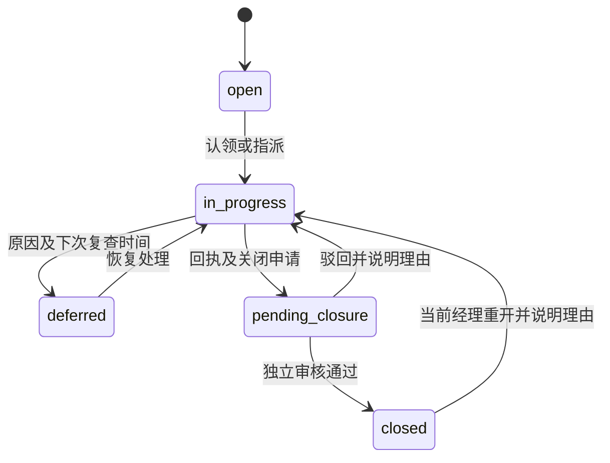

# 第二阶段：采购事项协作与流程续接设计

日期：2026-10-23；代码基线：`c74eea59`；状态：待用户审阅的设计草案。

用户已确认方向：保留现有架构、逐步统一业务规则、按用户流程交付。
第二阶段覆盖 ISS-20261022-019、020、021、022、024。
本文中的审批、关闭与默认负责人规则是本次设计建议，尚未作为用户已批准政策。
本轮仅交付文档；随文实施计划也为草案，不代表已获产品代码实施授权。

## 1. 用户结果与范围

采购员能找到本人事项，接手处理，记录进展，提出关闭；经理能查看本科室事项、
分派责任、独立复核关闭。寻源用户能让已确认的候选继续，并从历史任务恢复同一需求。
首页回答“今天有哪些事需要我处理”，并显示尚未核验的覆盖缺口。

三批交付顺序固定：2A 复核事项协作 → 2B 寻源任务续接 → 2C 真实待办首页。
每批独立验收，上一批可用后再进入下一批；避免一次重写任务和 Agent 平台。

不包含自动采购、供应商准入、自动改变飞书责任关系、跨科室自动共享、
新建通用工作流引擎、付费来源自动重采集、外发提醒、第三阶段分析模型扩展。
来源缺失不强迫采购员上传外部资料；事项关闭不等于供应商已安全或资料已齐全。

## 2. 已核实的现状与方案选择

| 当前实现 | 保留的基础 | 第二阶段修改点 |
| --- | --- | --- |
| `domains/alert/review_tasks.py` | PG 任务、版本、事件、证据、执行结果 | 按动作授权；关联业务事项 |
| `domains/supplier/access.py` | 飞书身份、当前责任快照、经理科室读取范围 | 增加明确的科室管理能力判断 |
| `domains/alert/service.py::_can_access_target` | 正式供应商责任范围、外部对象私有范围 | 继续作为可见性门禁 |
| `domains/agent_run` | PG run、候选、事件、灰度、恢复与取消 | 候选处置、列表和受权交接 |
| `sourcing_risk_v2` | 专用寻源页面图与 checkpoint | 候选分组、恢复条件和调查过滤 |
| `ChatView` / `Harness` | 单次上下文快照、唯一只读运行时 | 消费服务端受权的寻源交接上下文 |
| `Dashboard` | 风险概览、监控数据和刷新 | 本人/科室队列、未知风险可见性 |

`UserRole` 只有 admin/purchaser/analyst/viewer；科室经理来自当前飞书责任快照，
不能凭空新增 `manager` 字符串并假设现有登录系统能提供它。
正式供应商可见范围包含采购责任或经理科室；外部对象仍仅所有者及管理员可见。

考虑的方式：

1. 在 `monitor_review_tasks.status` 加处理状态：修改少，但会继续混淆计算结束和事项关闭，
   且破坏旧 API 的状态语义，不采用。
2. 增加 PG 业务事项并链接现有执行记录：少量新表，业务状态独立，复用已有执行能力。
   **推荐本方案**，符合用户已经选择的渐进重构方向。
3. 引入通用工作流/权限引擎：迁移和配置成本大，当前范围没有充分理由，不采用。

## 3. 统一的权限规则

每个请求以服务端身份和**当前**责任关系计算能力；客户端传入的 owner/department/name
均不能授予权限。列表、计数、详情、操作、交接和执行时都要校验。

| 操作 | 采购员/历史 analyst | 当前科室经理 | 管理员 | viewer |
| --- | --- | --- | --- | --- |
| 事项读取 | 当前可见对象的本人创建/分派事项 | 本科室正式对象事项 | 全部 | 拒绝新协作入口 |
| 发起事项 | 当前可访问对象 | 本科室正式对象 | 全部 | 拒绝 |
| 认领 | 本人可访问且未分派的本人事项 | 本科室未分派事项 | 全部未分派事项 | 拒绝 |
| 指派/转交 | 只能请求转交，不能自行扩大责任范围 | 本科室范围内 | 向有对象权限的活跃账号 | 拒绝 |
| 记录回执/搁置/恢复 | 当前负责人 | 本科室，可接手后处理 | 可接手后处理 | 拒绝 |
| 提出关闭 | 当前负责人 | 接手后提出 | 接手后提出 | 拒绝 |
| 批准/驳回关闭 | 无 | 本科室，且不是关闭申请人 | 不是关闭申请人 | 拒绝 |

正式对象跨多科室时，事项创建时从当前有效责任记录选择一个 `department_code`；
只有一个候选可自动选择，多于一个必须显式选择，不能按第一条猜测。
创建后 scope 固定，读取仍重验该部门当前映射；负责人失效或撤权后不再能访问或处理。
经理调岗不会继承原部门权限，新经理能看到仍属其当前科室的事项。
外部/未解析对象不借用同名正式供应商范围；事项部门为空，所有者及管理员处理，
关闭需要另一名管理员审核；无人可审时保持待审核并明确提示，不放行自批。

技术复核任务的 `pending_approval` 在现有五种只读动作下定位为“待确认执行”。
本人或有管理权的经理可以确认/拒绝；执行者必须仍具对象权限且为发起人、
关联事项负责人或范围经理。viewer 禁止。此规则不改变其他 ActionProposal 的审批政策。
高影响写动作继续走现有持久化 Supervisor/ActionProposal，不能复用此自确认放行。
任务与关联事项必须同时满足访问门禁；旧任务按发起人或当前范围经理授权。

## 4. 2A：事项模型和处置规则

### 4.1 事项与技术任务分开

新 `procurement_cases` 为业务事实源；技术执行继续保存在 `monitor_review_tasks`。
二者用 `procurement_case_tasks` 关联，一事项允许多轮执行；原任务结构与结果不变。
事项类型只取 `risk_review`、`coverage_gap`、`identity_review`。

事项包含：id、monitor_target_id、company_id（可空）、department_code（可空）、
case_type、scope_key、trigger_key、title、priority(high/normal)、status、created_by、
owner_user_id（可空）、due_at（可空）、next_review_at（可空）、version、
closure_request（可空）、created_at、updated_at、closed_at（可空）。
scope_key 来自稳定对象、部门及业务范围，不由企业名称生成。
trigger_key 来自告警/评估/覆盖缺口指纹；同一触发下重复点击返回同一未关闭事项。
无触发 ID 的手工事项使用 `manual`；同对象、类型和 scope 的 manual 活动事项去重。

事件 `procurement_case_events` 追加保存 actor、操作、前后状态、理由、回执引用、
request_id、版本及时间；不覆盖旧回执。新事项和首条事件必须同事务写入。
事件、回执为处理记录；用户填写的“已解决”不能进入正式风险证据或修改评估。

### 4.2 状态、期限与关闭

`due_at` 由负责人或经理明确设置，首版无默认 SLA；无期限显示“未设期限”。
搁置必须有非空原因和未来 `next_review_at`；搁置不暂停原 due_at。
到期不自动改变状态；队列根据服务端 UTC 时间计算逾期/应复查，页面用本地时区展示。
closed 没有逾期标记；重开若原 due_at 已过则重新显示逾期。

关闭类别：`resolved`、`accepted_limitation`、`duplicate`、`withdrawn`。
申请需 summary、处置回执引用；accepted_limitation 还需 residual_limitations；
duplicate 需受权且同对象同 scope 的目标事项 ID，禁止自引及循环。
resolved 若针对数据覆盖/主体问题，必须链接新取得的对应有效证据或已核验主体记录；
后端复用第一阶段有效性判断。证据仍不足时只能申请 accepted_limitation。
人工闭环不删除未覆盖状态；经理接受限制也不改风险分、不生成 clean。
所有类别都需独立经理/管理员批准，禁止申请人自批。审批时重验权限、版本、
关闭材料和证据时效；驳回必须有理由。重开需理由，保留之前关闭记录。

### 4.3 执行、重复请求与故障

创建、状态变更、指派、回执、关闭均带 Idempotency-Key；状态变更带 expected_version。
同 key 同请求重放原结果；同 key 不同 payload 返回 409；不同用户不能复用他人 key。
所有写事务锁定事项、校验当前权限/版本、写事件、递增版本；并发冲突返回 409。
活动事项唯一键为 target/type/scope/trigger；关闭后同触发可另开，但需关联前事项。

“再次核验”关联一次现有技术任务，失败和 needs_review 都保留在同事项内。
2A 只使用已注册动作和当前数据源能力；缺少采集适配器时记录待协调和覆盖限制，
不以再次读取旧数据伪造补采成功。任务 completed 不自动关闭事项。
现有技术任务终态写回仍是原实现；涉及其权限调整必须验证执行前撤权，
对正在执行任务的租约和外呼恢复不另建执行器。

新模型按需关联旧任务，不把历史 completed 批量迁移成 closed。
现有列表、详情、成功字段集合不扩展；新增 `/api/v1/procurement-cases` 专用接口。
旧监控嵌入任务也需通过任务授权；无权时沿用原nullable字段返回None，有权时返回原结构，
前端展示执行摘要。新业务明细通过受权新接口加载，防止泄露事件和回执。

## 5. 2B：候选处置、任务历史与交接

### 5.1 候选独立决策

在 PG 新增 `sourcing_candidate_dispositions`，唯一键 `(run_id,candidate_key)`。
`candidate_key` 复用持久化候选 ID/review ID，不以可变企业名称或 company_id 充当键。
处置为 `confirm`、`defer`、`exclude`；confirm 需从当前受权候选选项中选 company_id，
defer/exclude 需理由，不设置 company_id、不声明 exact、不产生推荐资格。

新批次提交允许只提交部分候选；未出现的候选默认 defer，原因 `not_selected_this_round`，
页面提交前明确显示这一行为。已 exact 候选保留，不重新要求确认。
只对 exact 且未 defer/exclude 的候选调用调查、评分、提案；其余仍在结果页可见。
只有 defer/exclude 时返回持久化的“本轮无可核验候选”，不外呼、不产生正式推荐。
恢复 defer 候选使用新一轮受权决策；若原 run 已终态，创建引用父任务的新 run，
只调查本轮选择的候选，并保留父任务需求/规则版本引用与原结果，不复活旧终态。
终态派生必须先验证父任务权限、候选未排除及当前身份选项，禁止客户端注入候选。

专用寻源页面继续使用现有 sourcing_risk_v2 路径及灰度门禁；普通聊天仍只进入 Harness。
目前 identity_review 有 pending 返回而 runner 无条件进入调查的结构，必须加明确路由。
共享候选筛选规则下沉领域纯函数；不得为聊天重新激活旧寻源图。
所有恢复继续原样使用 LangGraph Command，重启后从 PG 决策恢复，不靠浏览器状态。

### 5.2 我的寻源任务

新增 `/api/v1/sourcing-workspace/tasks` 聚合读模型，来源为当前用户的
`agent_runs(run_type=sourcing_risk_v2)` 和兼容 `sourcing/requests`。
管理员可明确切换全局范围；首版经理不会自动读到采购员私有寻源任务。
返回 source_type、source_id、title、status、updated_at、resume_url，
按 `(updated_at DESC, source_type, source_id)` 稳定游标分页；limit 默认20，最大100。
兼容任务无updated_at时使用created_at作为排序时间并注明时间口径，不回写历史记录。
不同来源不合并为一个伪任务，不把 Harness 普通聊天全部塞入寻源历史。
run 来源继续受现有灰度控制；未开放时只显示可访问的兼容来源及说明。

### 5.3 候选到聊天的服务端交接

新增 POST `/api/v1/sourcing-workspace/handoffs`：输入 run_id、candidate_key、
expected_version、intent(`risk_review`/`monitor_proposal`)，带幂等键。
受权服务端读取需求快照、candidate/company ID、证据引用和原版本，
创建所有权绑定的新 Harness session，并在 PG 保存 `sourcing_handoffs` 绑定。
返回 handoff_id、session_id、chat_url；URL 只携 handoff_id/session_id，不塞完整证据或 token。

`ChatView` 先取受权交接详情，展示原任务/需求/候选；用户点击继续才发普通 chat 请求。
刷新恢复待继续状态，已消费绑定按请求回执恢复，不自动重复发消息。
`ChatRequest` 和 SSE 成功结构不改；API 在唯一一次 execution_context 加载中合并交接，
执行时重新校验父任务、候选当前主体和对象权限，过期证据只作为历史引用。
交接不得让外部候选绕过正式主体核验，不授予写入权限。
加入监控仍生成原 ActionProposal 并经人工确认；只读检查进入 Harness。

## 6. 2C：首页和事项入口

新增 `/cases` 列表及 `/cases/:caseId` 详情，共用事项组件。
“我的事项”与“本科室事项”由后端 capabilities 决定是否显示，URL 参数不授予权限。
监控详情增加“处理事项”和“技术执行记录”两块；历史任务的 completed 显示“执行完成”。

首页读取新 `/api/v1/procurement-workbench`，展示本人待处理、待我审核、逾期、
应复查和未知/过期/失败覆盖数量；每项均链接到精确事项或监控对象。
队列顺序：待我关闭审核 → 逾期 → 应复查 → high 优先级 → 普通事项，
组内 due_at 升序（空值最后）、updated_at 降序、id 升序；同事项只占最高一组。
覆盖缺口按 target 计数，不按维度重复计对象；与事项数量分别展示，不相加。
分布必须显示“未知”，有效当前风险、历史高风险和覆盖不足分别标识。
原风险分布可继续作为历史快照分布，但标题必须注明历史口径，分母与图例一致。
固定企业示例移到帮助区，不作为真实待办；请求失败显示未知或失败，不显示 0 待办。

首版仅站内队列与已有查询失效机制，无飞书/邮件外发、后台 SLA 提醒或自动升级。
聚合部分来源失败时返回该部分 unavailable，不能拼成“全部完成”。

## 7. 兼容、迁移与发布

PG 增量建表/索引；采用新 domain 目录已有模式，不增加前端 services/store/features。
新表保留 FK、版本检查及状态约束；处理记录只追加，账号删除保留 actor ID 的历史表示。
不修改旧 API 返回结构、既有 SSE 事件格式或历史评估，不回填历史业务关闭状态。
新旧入口并存期间，共用同一授权函数和领域服务；前端根据 capabilities 显示动作。
关闭新入口可回退至原监控/寻源页面；新增数据保留，不删除事件，不重放已确认写动作。
不修改活动聊天内核、不在领域服务导入 LangGraph；交接适配仅在 API/adapter 边界。

## 8. 验收与业务观察

| 场景 | 可验证结果 |
| --- | --- |
| 采购员创建→经理认领/分派→负责人回执→经理关闭 | 同事项保留全历史，关闭申请人不能自批 |
| 撤权、调岗、外部私有对象、跨科室枚举 | 列表/计数/详情/操作一致拒绝，分派不授予读取权 |
| 多次执行仍缺资料→接受限制关闭 | 保留残余缺口，风险不转绿，任务与事项状态独立 |
| 两人同时关闭/指派、重试同一请求 | 一次有效转移，冲突明确，无重复事件或外呼 |
| exact+未知候选混合，未知暂存/排除 | 仅 exact 调查，其余可见，不阻塞、不自动绑定 |
| 离开寻源页面→历史找回→候选交接→刷新→继续核验 | 同需求和稳定主体可追踪，重复刷新不自动执行 |
| 无范围经理或未设期限 | 分别显示待管理员审核、未设期限，不虚构完成或逾期 |
| 首页只有陈旧或缺源数据 | 未知/过期可见，点击进入准确对象，失败不显示0 |

试用期观察事项首响应时间、关闭时间、重开率、accepted_limitation 占比、
寻源候选继续率和任务找回成功率；本阶段记录创建/操作/关闭时间即可支持基线，
不预设无实测依据的节省比例。权限、并发和关键旅程的固定验收必须全部通过。

## 9. 需用户审阅的产品选择

1. 只读任务采用“确认执行”；业务事项关闭采用独立经理/管理员审核。
2. 外部私有事项没有科室经理范围时，由另一名管理员审核关闭。
3. 搁置需原因和下次复查时间；不设置默认 SLA；接受限制可以关闭事项但保留未知风险。
4. 未选寻源候选按本轮暂存；终态候选恢复创建关联的新任务。
5. 三批按 2A→2B→2C 顺序实施；不将正式数据源接入或高级分析扩展混入本阶段。

这些选择可在审阅中调整；需要调整时同步修改对应计划和验收用例后再实施。

## 10. 文档验证记录

2026-10-23：独立工程审阅返回 `nothing important left`，未发现阻碍制定计划的重要问题。
随后完成三批计划的接口、文件路径、权限、迁移、兼容与验收映射自检。
这只表示设计可进入审阅，不代表业务政策已批准、代码已实施或系统测试已通过。
